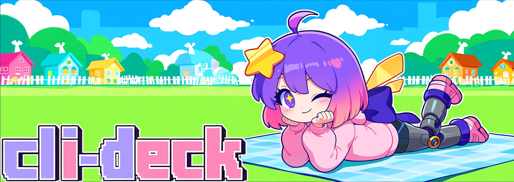

# cli-deck

[English](README.en.md) · [繁體中文](README.md) · [日本語](README.ja.md)



**ウィンドウを閉じてもターミナルのプログラムは動き続ける — あとで戻れば、離れたままの状態で再開できます。**

デーモンはベビーシッターのようなもの：あなたが不在のあいだ、プログラムを見守ってくれます。
全画面ダッシュボードは、いつでも手に置けるリモコンのようなものです。

| 機能 | 仕組み | 例 |
|---|---|---|
| **プログラムはウィンドウより長生き** | 小さな背景のヘルパーがプログラムを所有するのであって、ターミナルが所有するのではありません。ダッシュボードを閉じても何も kill されません。 | `cli-deck ssh prod`、その後ターミナルを閉じる |
| **いつでも飛び戻る** | ダッシュボードを開き直し、行を選んで `t`：全画面テイクオーバー、あなたのキー入力が入り、プログラムの画面が出てきます。 | `cli-deck --resume` |
| **あなたの shell はそのままあなたの shell** | コマンドは `bash -ic` 経由で実行されるので、エイリアス・関数・PATH がそのまま効きます。 | `cli-deck vim notes.md` |
| **留守のあいだの出来事がわかる** | 直近約 200 KB の画面出力が、再接続時に再生されます。 | `t` を押す |
| **触らずに見る** | `enter` で読み取り専用のライブ表示＋スクロールバック。キーはプログラムに届きません。 | `enter` を押す |
| **自動再起動（保護）** | `p`で行をマーク。プログラムが自ら終了したら、ヘルパーが再起動します。 | `p` を押す、または `cli-deck -p <cmd>` |
| **ログは保持・上限つき** | 各プログラムに生のログファイル。成長に上限があり、ディスクを圧迫しません。 | `cli-deck -d <cmd>` がログのパスを表示 |

## インストール

### ソースから

uv をインストールしたうえで、リポジトリのルートで実行：

```sh
make install   # uv tool install .  -> PATH に `cli-deck`、+ shell wrapper
```

新しい shell を開くか `source ~/.bashrc.d/cli-deck` して wrapper 関数をロード。
`make uninstall` で解除、`make deps` で開発環境を準備。
[Wrapper の詳細](docs/reference.md#shell-wrapper)（英語）。

### AppImage（Linux）

[Releases](https://github.com/scott1028/cli-deck/releases) から AppImage をダウンロード：
Intel/AMD は `x86_64`、ARM は `aarch64`。Python 同梱、uv 不要。
ダウンロードファイルを `cli-deck.AppImage` にリネームしてインストール：

```sh
install -Dm755 cli-deck.AppImage ~/.local/bin/cli-deck
```

FUSE がない環境では、コマンドの前に `APPIMAGE_EXTRACT_AND_RUN=1` を付けてください。

### macOS（tarball）

[Releases](https://github.com/scott1028/cli-deck/releases) から tarball をダウンロード：
Apple Silicon 専用の `macos-aarch64`。Python 同梱、uv 不要。
好きな場所に展開し、ランチャーを PATH に置きます：

```sh
tar xzf cli-deck-macos-aarch64.tar.gz -C ~/.local/share/cli-deck
ln -sf ~/.local/share/cli-deck/bin/cli-deck ~/.local/bin/cli-deck
```

macOS が初回実行をブロックしたら、ダウンロードフラグを解除：
`xattr -dr com.apple.quarantine ~/.local/share/cli-deck`。

### Windows（WSL）

ネイティブの Windows 版はありません。WSL の中で Linux と同じ方法（ソースから、または AppImage）でインストールしてください。

## 1行でスタート

```sh
cli-deck vim notes.md    # deck の下で vim を起動し、ダッシュボードを開く
```

ターミナルはいつ閉じても OK — vim は動き続けます。あとで：

```sh
cli-deck --resume        # 実行中の deck に再接続（または cli-deck -r）
cli-deck -l              # 生きている deck（名前、socket、pid、経過時間）と中のプログラムを表示
```

vim の行を選んで `t` を押すと画面をテイクオーバー。`Ctrl-]` でダッシュボードへ。
プログラムはその間一度も止まりません。

## よく使うコマンド

| コマンド | 役割 |
|---|---|
| `cli-deck` | ダッシュボードを開く（必要ならヘルパーを起動） |
| `cli-deck <command>` | deck の下でコマンドを開始し、ダッシュボードを開く |
| `cli-deck -r` / `--resume` | 実行中の deck に再接続 |
| `cli-deck -l` | 生きている deck と各 deck のプログラムを表示（再接続先選びに） |
| `cli-deck -d <cmd>` | 登録のみ；再接続のレシピを表示（コマンドなしならヘルパーを起動するだけ） |
| `cli-deck -p <cmd>` | 保護をオンにして開始、`p` と同じ（既定：連続の短時間再起動は 5 回まで、間隔 5 秒）；値は `=` でつなぐ：`-p=-1,2` = 無制限、2 秒 |
| `cli-deck --stop <id>` | 行を停止 |
| `cli-deck --restart <id>` | 行を再起動：同じコマンドで、id は新しくなる |
| `cli-deck --rm <id>` | 終了した行を削除；ログは残る |
| `cli-deck --up <id>` | 行の保護をオフ（長い形：`--unprotect`） |
| `cli-deck -- -L 80:localhost:80` | `--` 以降はすべてあなたのコマンド |

`-l` は deck ごとに 1 行、その下にプログラムをダッシュボードと同じ列で
字下げ表示します。`protect` 列に値があれば保護中の行です。記録された pid が
存在すれば deck は生きています；無効な項目は掃除されます。deck 名は
`CLI_DECK_NAME` 由来（既定は `default`）。

`--stop`・`--restart`・`--rm`・`--up` は `CLI_DECK_NAME` の deck にだけ作用します。
保護中の行は `--up` するまで `--stop` も `--rm` も受け付けません。詳しくは
[シェルから行を操作する](docs/reference.md#row-actions-from-the-shell)（英語）。

## ダッシュボードのキー

| キー | 動作 |
|---|---|
| `a` | プログラムを追加（空 = 素の bash、それ以外はあなたのコマンド） |
| `enter` | 読み取り専用のライブ出力＋スクロールバック（キーは送られません） |
| `t` | 選択中のプログラムの全画面テイクオーバー |
| `Ctrl-]` | テイクオーバーを離れ、ダッシュボードへ |
| `x` | 停止または削除（実行中の行は確認あり；既定は No） |
| `r` | 再起動：同じコマンド・cwd・環境で、新しい行 id |
| `p` | 保護：プログラムが自ら終了したら自動再起動 |
| `d` | ダッシュボードを閉じる；すべて動き続けます |
| `q` | ヘルパーを停止（確認あり — 実行中のプログラムは kill されます） |
| `b` | 一覧へ戻る |
| `esc` | プログラムへ送られるので、vim などそのまま使えます |

確認ダイアログは既定で **No** にフォーカス、Enter でキャンセル。
[キー別の挙動](docs/reference.md#dashboard-key-details)（英語）。

## 仕組み（簡潔版）

2つの部分から成ります：疑似ターミナルでプログラムを所有する分離型デーモンと、
Unix socket 経由でそれと会話する使い捨ての Textual TUI。
デーモンは自分の session で動き SIGHUP を無視するので、TUI（やターミナル全体）を
閉じても何も kill されません。テイクオーバー中は TUI を一時停止し、
あなたのターミナルとプログラムの pty の間で生のバイト列を双方向へ中継します —
だから vim、ssh、htop がネイティブに描画されます。

## 開発

```sh
make deps    # uv sync
make test    # unittest 一式
```

`pyproject.toml` の `version` を上げて `master` へ push すると、
テスト実行 → Linux AppImage と macOS tarball のビルド →
`v<version>-<commit 先頭8文字>` タグの release 公開が行われます。

## 詳細

- [完全リファレンス](docs/reference.md)（英語）：アーキテクチャ、プロトコル、
  保護、teardown、ランタイムファイル、環境変数、リポジトリ構成。
